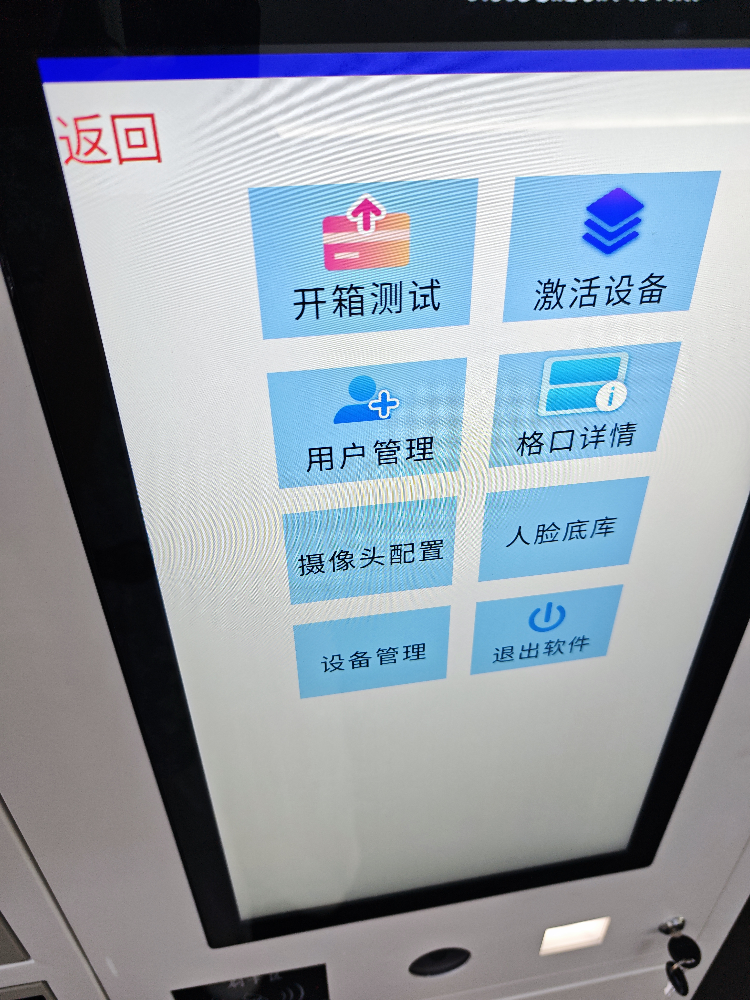

# 柜机学校管理员手机号验证码登录需求

版本：v2.0
日期：2026年10月24日
适用分支：huwei-cabinet

## 1 需求目标与范围

后台管理平台创建学校管理员后，后台同时创建对应的柜机管理员账号。学校管理员可使用登录名（手机号）接收短信验证码，登录同校柜机的管理员账号。

本次只新增学校管理员手机号验证码登录及后台账号创建、权限回收联动。登录成功后原样进入第三方现有柜机管理页面，页面及管理操作流程保持现状。

柜机管理员账号在后台创建和管理，不要求用户在柜机上手动新增账号。

## 2 后台账号创建与字段对应

| 柜机管理员字段 | 学校管理员字段 | 规则 |
| --- | --- | --- |
| 用户账号 | 登录名（手机号） | 用于手机号验证码登录 |
| 用户昵称 | 姓名 | 显示真实学校管理员姓名 |
| 所属学校 | 学校管理员所属学校 | 仅允许登录同校柜机 |
| 用户类型 | 柜机管理员 | 使用柜机现有管理员全部功能 |

后台创建学校管理员时，同时创建关联的柜机管理员账号；重复处理同一创建请求不得重复建号。后台须支持柜机账号创建、降级、恢复失败后的重试；失败或尚未完成不得标记为成功。关联关系应可追溯，不能仅凭显示姓名判断对应账号。

用户密码、用户卡号不纳入此次字段对应和登录要求，新增登录方式不要求输入柜机账号密码或用户卡号。

上线前，为已有学校管理员统一开通柜机管理员账号。尚无对应账号的创建关联账号，已有账号核对关联关系，不重复创建；开通后可使用手机号验证码登录同校柜机。

## 3 首页管理员入口与独立登录页

首页底部依次居中展示「人脸注册」「问题反馈」「管理员登录」。「管理员登录」位于「问题反馈」右侧，采用与其一致的白色圆角按钮样式；版本号及红点在按钮下方居中展示。

将原「学员登录」统一改为「学生登录」。学生登录及人脸注册页不展示管理入口。点击首页管理员入口后进入独立手机号验证码登录页，提供「返回首页」。

| 页面元素 | 内容及行为 |
| --- | --- |
| 标题 | 管理员登录 |
| 说明文案 | 使用本校学校管理员绑定的手机号登录 |
| 手机号 | 输入11位登录手机号 |
| 获取验证码 | 手机号格式正确后可点击；点击后先校验本校学校管理员资格，再校验关联柜机账号可用性，两项均通过才发送，发送成功后显示重发倒计时 |
| 短信验证码 | 输入6位数字验证码 |
| 登录 | 提交手机号及验证码，由后台完成校验 |
| 管理员入口 | 首页底部「问题反馈」右侧，采用相同的白色圆角按钮样式 |
| 返回首页 | 返回柜机首页，清理管理员登录表单和提示 |

登录页不展示此前删除的管理图标、「柜机管理 · A03」及「仅限本校授权管理员登录管理」提示。

## 4 登录流程与学校校验

1. 用户输入11位手机号，输入阶段只检查手机号格式，不查询账号是否存在。格式正确后允许点击「获取验证码」。
2. 点击「获取验证码」后，后台先检查手机号是否具有当前柜机所属学校的学校管理员资格。不符合时Toast提示「账号不存在」。资格符合后，再检查关联柜机管理员账号是否可用；账号创建失败、尚未完成或权限恢复未完成时，Toast提示「管理员账号暂不可用，请联系平台管理员」。以上情况均不发送验证码。
3. 本校学校管理员资格符合且关联柜机管理员账号可用后，后台通过现有短信平台发送柜机管理员登录验证码；请求处理中防止重复点击，发送成功后开始倒计时。
4. 后台先按获取验证码时相同的顺序复核本校学校管理员资格、关联柜机管理员账号可用性，再校验验证码；资格不符、账号暂不可用分别使用相同Toast提示并拒绝登录。
5. 全部通过后，登录后台已创建的柜机管理员账号，进入柜机现有管理员首页；登录时不在柜机本地创建账号。

手机号发生修改时，清除旧的错误提示和已输入验证码；格式正确且满足发送间隔时，可重新点击获取验证码，后台按新手机号重新校验资格。不能沿用旧手机号的验证码。

当前柜机身份及学校归属以服务端登记为准。柜机未绑定学校、学校归属异常或账号不属于本校时，不得登录。

## 5 权限回收与账号变化

| 后台变化 | 柜机管理员处理 | 登录结果 |
| --- | --- | --- |
| 创建学校管理员 | 后台同时创建对应柜机管理员账号 | 可在同校柜机校验资格并验证码登录 |
| 删除学校管理员 | 后台将该手机号对应的柜机账号用户类型改为普通用户，保留账号 | 不得再登录柜机管理员账号 |
| 将角色改为非学校管理员 | 后台将该手机号对应的柜机账号用户类型改为普通用户，保留账号 | 不得再登录柜机管理员账号 |
| 重新符合学校管理员条件 | 后台将原手机号关联账号用户类型恢复为管理员，保留账号及历史记录，不重复建号 | 恢复同校柜机验证码登录 |
| 统一学校校验 | 获取验证码和提交登录时均校验学校归属及学校管理员角色，不单独增加换校流程 | 仅符合当前柜机所属学校及管理员角色的账号可继续登录校验 |

权限回收后，即使持有此前获取且尚未过期的验证码，也不能完成登录；不能只在发送验证码时检查资格。

用户失去管理员权限后，须清除该账号在所有相关柜机上的管理登录状态并阻止继续管理。具体生效方式及管理操作中的退出衔接，由开发与第三方确认。

柜机管理员权限回收统一通过将柜机账号用户类型改为普通用户实现，保留账号和历史记录，不删除柜机账号。用户重新符合学校管理员条件时，后台将原手机号关联的柜机账号用户类型恢复为管理员，不重复创建账号；恢复后可在所属学校柜机上通过手机号验证码登录。后台删除学校管理员记录与柜机账号降为普通用户是两个联动动作。

同一账号支持同时登录所属学校的不同柜机，新登录不挤掉其他柜机的登录状态。资格被收回后，即使柜机账号降级同步尚未完成，也不得再建立管理员会话；须清除所有相关柜机上的管理登录状态。

## 6 登录后的功能与退出

柜机管理页由第三方既有实现提供，学校管理员登录成功后直接使用。管理页按既有页面展示，无需修改，页面及操作流程以下方参考图和第三方现有实现为准。本次仅接入学校管理员手机号验证码登录及后台账号权限联动。

沿用第三方既有操作边界、操作异常处理和后台现有操作记录能力，柜机不新增操作记录功能。

管理首页「返回」结束管理员会话并返回柜机首页；功能子页返回沿用第三方现有流程。

返回退出、无操作超时、软件重启后清除管理员登录状态。无操作超时时长待确认；管理操作执行中发生超时是否已有处理，由第三方确认，不在本次自行确定中断规则。

## 7 短信平台与验证码

复用教师端手机号登录已接入的短信平台及已有验证码服务方案。短信签名优先沿用教师端已审核签名，具体可用性由研发确认；新增「柜机管理员登录」短信模板，不能发送教师端登录用途的文案。

### 7.1 短信模板

> 【现有短信签名】您正在登录AI学伴柜机管理员账号，验证码为${code}，5分钟内有效。请勿向他人泄露验证码，非本人操作请忽略。

${code}为动态验证码参数，按平台实际参数格式配置。「现有短信签名」替换为实际可用的已审核签名，不作为字面内容发送。模板按短信平台流程配置和审核；柜机登录发送短信时，选用这份柜机管理员登录文案对应的模板编号，不使用教师端登录模板编号。

### 7.2 验证码规则

| 参数 | 要求 |
| --- | --- |
| 格式 | 6位随机数字，允许首位为0 |
| 有效期 | 生成后5分钟，短信内容与实际时效一致 |
| 重发间隔 | 同一手机号同一登录用途60秒 |
| 验证成功 | 立即失效，不可重复使用 |
| 成功重发 | 新码生效，旧码失效 |
| 发送频率、输错限制及异常处理 | 沿用教师端现有方案，由服务端执行 |

验证码由后台生成、发送及校验，与手机号和柜机管理员登录用途绑定。柜机不持有短信服务密钥，不生成或自行校验真实验证码，不在接口响应和日志中泄露验证码。

## 8 异常提示

| 场景 | 提示与处理 |
| --- | --- |
| 手机号为空或格式错误 | 请输入正确的11位手机号；不允许获取验证码 |
| 非本校管理员、已删除或角色已变更 | 获取验证码和提交登录时先校验本校学校管理员资格；无资格时Toast提示「账号不存在」，不发送验证码、不允许登录；输入阶段不查询资格 |
| 网络异常、资格校验服务异常或超时 | 获取验证码或提交登录时，Toast提示「网络异常，请重试」；校验未通过不得继续发送验证码或放行登录，请求结束后允许重试；不提示账号不存在，不改变用户类型或删除账号 |
| 验证码为空 | 请输入验证码 |
| 验证码错误或失效 | 验证码错误或已失效，请重新获取 |
| 发送、限流等短信异常 | 沿用教师端已有方案及提示规则 |
| 登录时学校管理员资格已被收回 | 拒绝登录，Toast提示「账号不存在」 |
| 具有本校学校管理员资格，但关联柜机账号创建失败、尚未完成或权限恢复未完成 | 获取验证码和提交登录时，Toast提示「管理员账号暂不可用，请联系平台管理员」，不发送验证码、不允许登录；后台支持创建、降级、恢复失败后的重试，失败或尚未完成不得标记为成功 |

## 9 联调确认事项

| 事项 | 需明确内容 |
| --- | --- |
| 后台联动建号 | 后台须支持柜机账号创建、降级、恢复失败后的重试，失败或尚未完成不得标记为成功；联调确认接口、关联方式及重试实现，避免重复建号 |
| 历史管理员 | 已确定上线前为已有学校管理员开通柜机管理员账号；联调仅确认执行方式、去重及开通结果核对 |
| 登录衔接 | 后台验证码验证通过后，第三方如何建立柜机管理员会话 |
| 权限回收 | 删除、删除学校管理员或改为非学校管理员后，须清除该账号在所有相关柜机上的管理登录状态；具体生效方式及操作中退出衔接由开发与第三方确认 |
| 同账号多柜机 | 已确认同一账号支持同时登录不同柜机，新登录不挤掉其他柜机的登录状态；各柜机仍须符合账号所属学校范围 |
| 超时 | 无操作退出时长、管理操作中超时处理是否已有机制 |
| 短信配置 | 签名可用性、柜机登录模板审核和模板标识；核对教师端现有参数与本需求一致性 |

以上为实施衔接项，不改变后台建号、同校登录、删除或改角色后回收权限的已确认业务规则。

## 10 验收要点

1. 后台创建学校管理员时，同步建立关联的后台柜机管理员账号；上线前已有学校管理员也须完成开通，已有账号不重复创建。用户账号为手机号，用户昵称为姓名。创建、降级、恢复失败须支持后台重试，失败或尚未完成不得标记为成功，重试不得重复建号。
2. 无需在柜机本地新增管理员账号，也无需输入柜机密码或用户卡号。
3. 获取验证码和提交登录均按顺序校验：先校验本校学校管理员资格，无资格Toast「账号不存在」；再校验关联柜机账号可用性，创建或恢复未完成Toast「管理员账号暂不可用，请联系平台管理员」。两类异常均不发码、不允许登录；网络或校验服务异常Toast「网络异常，请重试」，不继续发码或放行登录。
4. 有效学校管理员可通过短信验证码同时登录本校不同柜机，新登录不挤掉其他柜机的登录状态；跨校、无对应权限或资格校验失败时不得登录。
5. 删除学校管理员或改为非学校管理员后，将关联柜机账号用户类型改为普通用户，保留账号及历史记录，不删除账号；旧验证码不能继续登录管理员账号。重新符合学校管理员条件时，将同一手机号关联的原账号恢复为管理员，可再次通过验证码登录同校柜机，不重复建号。
6. 已登录账号权限收回后须清除该账号在所有相关柜机上的管理登录状态并阻止继续管理；具体生效方式由开发与第三方确认。
7. 登录成功后直接使用第三方已实现的柜机管理页，页面及现有管理操作流程无需修改。
8. 手机号修改后，下一次点击获取验证码时按新手机号校验；网络失败不能触发账号删除或错误撤权。
9. 短信使用柜机管理员登录模板，验证码参数与服务端一致，不接受原型固定演示验证码。
10. 返回退出、超时及重启后清除登录状态；管理操作中超时处理待第三方确认。

## 11 当前原型状态

原型仅为前端演示，模拟手机号13800000000、验证码123456放在左侧控制台，不属于正式登录方案。未接入真实短信、后台联动建号或第三方登录接口。

原型已展示八项管理入口，用于说明登录后的页面衔接。正式柜机直接使用第三方已实现的管理页，无需修改或重新开发该页面。手机号验证码登录及后台账号权限联动仍需接入，不以原型演示代替正式实现。
