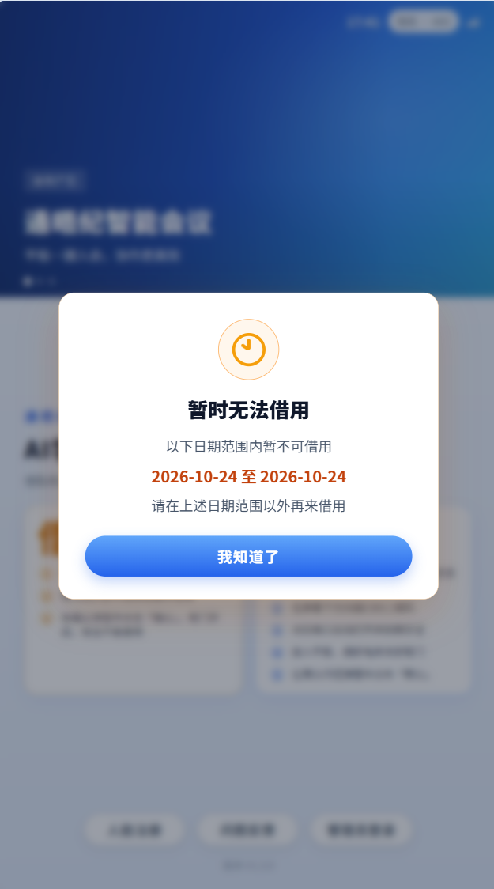

# AI学伴全校设备管控产品需求文档

版本：v2.59 ｜ 更新：2026-10-26

## 1. 需求概述

### 1.1 目标

本文说明学校管理员在教师端的全校设备管控、学生端响应及跨端共用业务规则。微信小程序的三类角色、页面与交互需求统一维护于[《微信小程序设备管控需求文档》](https://fcnw5yd4oj1w.feishu.cn/docx/Qcxdd67fIowvDOxLEl4cATd6ny2)。本期包含五个模块：

1. 柜机借用管控：设置学校借出时间与临时禁借，班主任管理关联班级的学生禁借。
2. 使用时长管控：限制学生使用设备的时长和可用时段。
3. 智阅作业管控：设置答案、详解的查看权限。
4. 万象视界管控：设置学生能否进入万象视界。
5. 锁屏管控：学校管理员临时锁定全校设备，可单独解除年级或班级的临时锁屏；结束全校管控后执行当前日常锁屏设置。

### 1.2 权限边界

| 教师端角色 | 数据范围 | 可操作内容 |
|-|-|-|
| 学校管理员 | 所属学校、年级、班级；最深到班级 | 使用五类管控，操作全校、年级、班级。借用可设置每周、日期规则及临时禁借，不直接操作具体学生；管理员锁屏为临时锁屏。 |

微信小程序的学校管理员、班主任及任课老师权限已迁移至[小程序需求的角色权限表](https://fcnw5yd4oj1w.feishu.cn/docx/Qcxdd67fIowvDOxLEl4cATd6ny2#doxcnRjMVvQXJcivwRmEBuTggfc)。本文涉及老师规则的条目用于定义共用优先级与执行逻辑，不表示教师端向老师开放入口。

- 教师端全校设备管控仅学校管理员可见、可操作，班主任和任课老师不显示入口。学校管理员是当前学校的最高管理角色，权限失效由平台管理员处理；移动端角色权限及页面交互参见[小程序独立需求文档](https://fcnw5yd4oj1w.feishu.cn/docx/Qcxdd67fIowvDOxLEl4cATd6ny2)。
- 前端角色判断只控制入口和功能展示。每次查询或修改必须由服务端校验教师与学校、班级、学科及有效学期的关联。
- 老师不得查看或修改无有效关联的班级和学生；班级关系失效后立即失去对应权限。

### 1.3 管控范围与规则优先级

- 学校管理员按模块和操作范围设置规则，各模块独立生效。
- **生效范围**

  - 借用、使用时长、智阅作业、万象视界和锁屏可同时生效。
  - 按星期或日期配置的模块，只修改本次选定日期；智阅作业和万象视界修改当前权限状态。
- 使用时长、智阅作业和万象视界均需选择「本次修改哪些学生？」：修改所选范围的全部学生，或保留老师已设置的内容、只修改其他学生。使用时长保留班主任设置，智阅作业和万象视界保留老师设置；具体判断方式见各模块。
- 是否保留老师设置按模块独立判断：使用时长按学生及星期，智阅作业和万象视界按学生当前设置。
- 学校管理员维护每周、指定日期借用规则，日期规则优先；学校临时禁借与班主任学生禁借独立生效，均可阻止新借出。班主任不配置时间规则，不设借用权限开关。
- 万象视界允许学校和有权限的老师调整学生使用状态，以该学生最后一次成功修改的结果为准。学校选择保留老师设置时，跳过这些学生。
- 新增学生的普通规则执行当前学校规则，不追溯历史批量操作；临时锁屏按当前所在班级的临时状态继承，班级已局部解除则不受临时锁屏限制。
- 学生转班后，借用时间规则及临时禁借跟随新班级，已有学生禁借保留并由新班主任接手。其他普通规则按以下规则处理，不继承新班级老师历史批量配置；

  - 使用时长无其他规则时执行全校默认。
  - 临时锁屏单独处理：立即跟随当前所在班级的临时状态，不携带原班级临时状态。
  - 日常锁屏按转班规则重新计算，无日常设置默认未锁屏。

### 1.4 核心术语

| 术语 | 含义 |
|-|-|
| 操作对象 | 学校管理员本次选择的全校、年级或班级；批量操作为已勾选的年级或班级。 |
| 影响学生 | 操作对象展开后实际被修改的去重学生 |
| 学校规则 | 学校管理员为指定范围保存的配置。使用时长无其他配置时执行固定默认值；各模块覆盖方式见对应章节。 |
| 当前生效规则 | 按日期、管控范围和最新成功操作计算后，学生实际执行的规则 |
| 汇总状态 | 根据范围内学生当前配置实时统计的结果 |

## 2. 通用交互

### 2.1 层级和选择

- 教师端全校设备管控采用「全校→年级→班级」层级，最深止于班级；不提供学生列表、学生详情或查看学生入口。班级行保留单项和批量设置。
- 教师端页面提供面包屑和返回上一级按钮；切换模块时保留当前层级。
- 教师端五类管控均使用年级、班级列表，默认不显示复选框，每行提供单项操作。借用支持每周与指定日期规则、临时禁借以及批量设置。
- **批量操作**

  - 五个模块均点击「批量操作」进入多选。
  - 进入多选后勾选对象，页面显示已选对象数与学生数。
  - 其他四个模块翻页时保留选择；借用不分页。切换层级或模块清空选择。
  - 设置面板的对象展示按各模块说明执行，保存确认可核对具体年级或班级。
- 批量操作仅影响已勾选对象；借用支持当前层级全选，其他四个模块支持本页全选和跨页勾选。未选择对象时不打开设置面板。
- 借用批量模式通过「退出批量操作」退出，其余模块通过「取消」退出；均清空勾选并隐藏复选框，不修改规则。
- 教师端切换层级或模块后清空勾选；其他四个模块回到第一页，翻页时保留跨页选择。
- 万象视界和锁屏的顶部全校按钮作用于全校；使用时长通过全选年级进行批量设置。

### 2.2 保存和操作记录

- **保存结果**

  - 借用时间规则和临时禁借按所选班级保存，学生按当前班级执行；使用时长、智阅作业及万象视界按范围展开为学生后去重保存。
  - 临时锁屏单独保存全校管控状态和班级临时状态，不覆盖日常锁屏。
  - 解除临时锁屏后执行日常设置，无日常设置时为未锁屏。
- 万象视界通过右侧抽屉设置，点击「保存」执行；临时锁屏通过弹窗选择开启或解除，并确认执行。
- 使用时长、智阅作业和万象视界的范围选择放在设置内容下方、操作按钮上方，标题统一为「本次修改哪些学生？」。选项需说明修改全部和保留老师设置的影响；使用时长按所选星期保留班主任设置，万象视界保留老师设置过的学生。
- **轻提示样式**

  - 统一在顶部居中显示，包含状态图标、文字及关闭按钮。
  - 成功用绿色，校验或保存失败用红色，冲突或权限限制用橙色，操作指引用蓝色。
  - 普通提示约4.5秒消失，填入或恢复默认的成功提示约3秒消失；均支持手动关闭。
- **表单校验**

  - 点击保存或确认时检查必填项和参数；校验失败显示红色提示并保留已填内容。
  - 使用时长和万象视界先检查修改范围是否选择，再检查其他必填项。
  - 使用时长可用时段为空表示全天可用；指定日期选择全天禁止借用时，无须填写借用时段。
- 临时锁屏弹窗和万象视界抽屉的「取消」直接关闭，不保存，也不再次确认。其他关闭方式沿用未保存提醒。
- 接口成功后更新列表、汇总状态和操作记录；失败时保留原配置并提示原因。
- 使用时长、智阅作业、万象视界和锁屏的年级、班级表格展示「最后操作人」「操作时间」，取当前范围内对应模块最近一次成功操作；无记录显示「—」。借用管控通过页面右上角「操作记录」查看规则及临时禁借的修改内容、操作人和时间。
- **记录来源**

  - 教师端操作记录只收录教师端学校管理员的操作。
  - 小程序操作不进入该列表，但仍按业务规则同步配置和最近操作信息。
- **操作记录入口与内容**

  - 各模块全校页面顶部提供「操作记录」，点击打开抽屉；借用在年级页面也保留该入口，记录仍为本模块全校记录。
  - 说明为「仅记录教师端学校管理员的操作，每个模块显示近100条记录」。
  - 五个模块统一采用记录卡片，依次显示操作内容、操作对象、操作人和时间。操作对象取保存时记录的具体范围；修改前后默认收起，点击「查看修改前后」展开。
- 操作记录只读。表单内的默认设置按钮仅填写默认值，保存后才修改实际配置。
- **记录生成**

  - 成功保存规则、变更临时禁借或临时锁屏、调整班主任时长权限后生成记录。
  - 仅填写表单、填入默认值、取消和校验失败不生成记录。
  - 各模块独立保留最近100条记录。
- **最终保存冲突校验**

  - 借用打开设置时记录学校借用配置版本；使用时长、智阅作业和万象视界记录所选学生对应模块的版本。
  - 浏览列表和打开编辑时不提示冲突；编辑过程中保留已填内容、不打断。借用、时长、智阅仅在最终确认提交时检查并提示；万象视界在抽屉点击「保存」时检查并提示。
  - 检查配置及设置来源是否变化，其他模块的变化不阻止本次保存。
  - 借用配置版本变化时本次不保存；其余模块任一所选学生对应模块发生变化时整批不保存，包括原本准备跳过的学生。
- 版本冲突时不允许部分成功，也不允许强制覆盖。
- 冲突时关闭设置、刷新数据，显示橙色提示「相关设置已被其他人修改，本次未保存，请重新设置。」管理员重新打开并核对后才能保存。
- 万象视界学校和老师可先后调整，以实际修改学生的最新保存结果为准；被跳过或状态无需变化的学生保留原状态和最近操作记录。
- 批量保存采用整批成功或整批失败；设备离线不影响服务端保存，设备恢复联网后同步最新规则。

### 2.3 列表

- 教师端五类管控的年级和班级列表均不提供搜索框、状态筛选、清空搜索或清空筛选入口。
- 借用管控的年级、班级临时禁借列表展示当前层级全部对象，不提供分页或每页数量选择；其他四个模块列表默认每页10条，可切换为20条或40条。
- 年级、班级层级均保留标题、批量操作和单项设置入口；点击年级进入班级层级。借用规则在独立模块逐条展示，借用的年级/班级列表只操作临时禁借；其他四个模块维持表格展示。各模块不展示序号和年级下的班级数；其他四个模块表头及对象名称14px，规则和说明正文12px。
- **使用时长列表**

  - 「当前主要生效规则」展示范围内执行人数最多的一组完整整周配置，并按星期合并展示相同参数。
  - 未设置其他规则时显示固定默认值。
- 整周配置按星期、连续使用、休息、每日累计和可用时段共同分组。多组人数并列最多时取其中一组；规则列只展示该组规则。「说明」列根据整周配置是否一致，显示「学生规则有差异」或「学生规则一致」。
- 万象视界列表展示使用状态；锁屏列表展示管理员临时锁屏状态。具体列见各模块。
- 当前规则按实际生效星期合并展示：连续三天及以上使用「周一至周五」「周一至周日」等区间；一至两天或不连续日期逐项展示，如「周一、周三」或「周一至周三、周五」。

### 2.4 无数据与异常处理

**操作对象发生变化：**打开设置后，学生转班、移出学校或班级被删除等导致所选对象发生变化，最终提交时应再次校验。发现变化则整批不保存，关闭设置、刷新对应列表并清空选择，显示橙色提示「所选范围的学生或班级已变化，请重新选择后设置。」管理员重新选择后再设置。

| 场景 | 展示和后续操作 |
|---|---|
| 学校暂无年级 | 保留页面标题、模块切换和层级导航，在年级列表内显示「学校暂无年级」，提示先完善年级信息；不提供无对象的批量设置。 |
| 年级暂无班级 | 保留页面结构，在对应年级的班级列表内显示「该年级暂无班级」，提示先添加班级，可返回全校。 |
| 班级暂无学生 | 保留页面结构，在对应班级的列表内显示「该班级暂无学生」，不允许提交设置；学生加入后再设置，可返回全校。 |
| 列表加载失败 | 当前模块显示加载失败缺省页，提示检查网络，提供「重新加载」。加载成功后恢复列表；不能误显示为暂无数据。 |
| 保存失败 | 设置抽屉保留已填写内容，顶部显示红色提示「保存失败，请检查网络或稍后重试。已填写的内容已保留。」管理员可重试或取消；原配置和操作记录不变。 |
| 设置被他人修改 | 最终提交时校验，整批不保存，关闭设置并刷新对应模块列表；显示橙色提示「相关设置已被其他人修改，本次未保存，请重新设置。」重新核对后再设置。 |
| 管理员权限失效 | 停止查看和修改全校管控，直接显示无权限缺省页，提示联系平台管理员。 |

## 3. 柜机借用管控

### 3.1 职责与生效条件

柜机借用管控只决定设备能否从柜机借出，不限制借出后的使用时长。禁止借用不影响正常归还。

- 学校管理员设置全校、年级、班级的每周规则和指定日期规则，操作临时禁止借用，最深到班级，不操作具体学生。
- 班主任默认可管理当前关联班级的学生禁借，支持单人、批量禁止和解除；不设置借用权限开关，不配置每周或指定日期规则。任课老师不提供借用管控。
- 学校临时禁止借用时，受影响班级不能新借出；班主任已禁止的学生也不能新借出。
- 未被上述禁借限制的学生，优先执行当天有效的学校指定日期规则；没有有效日期规则时执行每周规则。
- 未设置任何借用规则时，默认均可借用；学校临时禁借和班主任禁借优先。当天没有有效日期规则且未设置每周规则时，默认可借；已设置每周规则但当前星期或时段未覆盖，以及日期规则全天禁止或时段外，均不能借出。
- 全校页面说明：「未设置借用时间时，学生可随时借用；设置后，按规定时间借用。」
- 解除说明：「学校临时禁借期间，相关学生不可借用。解除后，按当前借用安排执行；班主任单独设置的禁借仍需班主任解除。」

### 3.2 每周固定借用规则

- 适用星期与借用时段必填，星期一至星期日可多选，至少一组时段。
- 每组结束时间须晚于开始时间，不支持跨日，时段不可重叠。
- 可按年级、班级单项或批量设置；全校统一设置通过勾选全部年级完成。规则保存到所选班级，新增学生执行所在班级当前规则。

### 3.3 指定日期借用规则

- 设置开始日期和结束日期，包含起止日期，可为同一天；开始日期不得早于学校当天，结束日期不得早于开始日期。
- 可选择按时段借用或全天禁止借用；全天禁止无须填写时段。
- 指定日期规则优先于每周规则，不叠加时段；学校临时禁借和学生禁借仍然生效。
- 可按年级、班级单项或批量设置；全校统一设置通过勾选全部年级完成。抽屉显示实际选择范围和影响学生数，不固定写为全校，不提供跳过老师设置选项。
- 开始日期前为待生效，起止日期内为生效中，结束日期次日起为已失效。时段外仍显示生效中；日期及状态按学校时区判断。
- 已失效规则保留展示，仅可删除、不可编辑；新增和编辑提交按钮统一为保存。
- 到期或删除后，按仍有效的日期规则或每周规则执行；没有当天有效日期规则且未设置每周规则时，默认可借用。

### 3.4 学校临时禁止借用

- 学校管理员可临时禁止全校、年级或班级借用，支持单项和批量操作。开启、解除均先确认范围和影响人数。
- 单个年级或批量所选范围同时包含已禁借和未禁借班级时，只显示一个「设置临时禁借」入口。点击后在弹窗中选择「临时禁止借用」或「解除临时禁借」，显示各自将改变的班级数；选定操作后列出本次实际涉及的班级。下一步只确认实际变化的班级与学生人数，未变化班级保持原状。范围内状态一致时，直接显示对应的单项操作按钮。
- 临时禁借独立保存，不修改每周规则、日期规则及班主任已有的学生禁借；只阻止新借出，不中断已借出设备的使用。
- 开启全校临时禁借后，全校按钮变为「结束全校临时禁借」，不随局部解除或当前禁借人数变化。
- 全校管控期间可单独解除或重新禁止某年级、班级；局部解除不结束全校管控，对应班级班主任立即恢复借用操作，其他仍禁借的班级继续只读。
- 受临时禁借影响的班级，班主任查看到的全班学生均为禁止借用，操作不可用，提示「学校正在临时禁止借用，暂时无法修改」。最终提交也要检查班级是否已进入临时禁借。
- 结束全校临时禁借时，清除本次全校临时限制及所有局部例外；没有全校会话时，解除年级或班级仅影响所选范围。
- 解除文案统一为「解除临时禁借后，按当前有效的借用规则执行，保留已有的学生禁借」。
- 管理员在临时禁借期间仍可维护时间规则；保存时间规则不解除临时禁借。
- 刷新、退出登录不结束临时禁借；重新进入后状态保留。

### 3.5 班主任学生禁借共用规则

- 班主任按当前关联班级查看学生，单个或批量禁止借用、解除禁借；禁借立即生效，持续到当前有权限的班主任手动解除，不设置日期或自动到期。
- 学校临时禁借期间只读；所在班级解除后恢复操作，无须等待全校临时管控结束。
- 解除学生禁借后按学校当前有效的时间规则执行，不代表学生此刻一定可借。
- 班主任更换后，新班主任接手关联班级的已有学生禁借，不限定原操作人解除。
- 学生转班后，已有学生禁借保持原状态，由新班主任接手；每周、日期和学校临时禁借跟随新班级。
- 新增学生不继承班主任历史批量禁借，执行当前所在班级的学校规则与临时状态。
- 本节定义跨端共用业务规则，本次教师端原型仅实现学校管理员入口；不新增班主任或任课老师入口。

### 3.6 冲突、覆盖与页面操作（原型 1.3）

- 原型版本：1.1 为此前列表版（本地标签 `borrowing-control-v1.1`）；1.2 为卡片版（本地标签 `borrowing-control-v1.2`）；1.3 为简化版。1.2 保留为可恢复检查点，当前实现以 1.3 为准。
- 页面上方独立展示「借用规则」模块。点击「新增规则」，先选择每周固定或指定日期，再选择全校、整个年级或指定班级；选择指定班级时先选年级，再勾选该年级的班级。确认对象后进入时间设置。每次新增形成一条可单独管理的规则，列表逐条展示规则类型、日期或星期、时段和适用范围，并提供编辑、删除。指定日期规则同时显示生效状态；已失效规则可查看或删除，不可编辑。
- 同一规则应用于多个班级时，在规则模块合并为一条展示；分别新增的规则即使内容相同，也保留为独立条目。编辑或删除只影响该条规则所覆盖的班级。指定日期与每周固定规则同时存在时，指定日期规则优先生效。
- 页面下方的年级、班级列表只用于临时禁借，不展示时间规则摘要，也不提供设置时间规则的入口。学校列表展示一至九年级；点击年级进入该年级全部班级，返回全校或切换层级时退出批量操作并清空勾选。年级和班级列表不分页。
- 列表展示当前临时禁借状态及单项操作；同时包含已禁借和未禁借班级的对象，使用「设置临时禁借」选择开启或解除。批量操作只选择对象并设置临时禁借，勾选模式隐藏单项操作；全选仅作用于当前层级。确认前展示实际将改变的班级与影响人数。
- 新增或编辑表单不重复展示「原配置」板块。对象覆盖完整年级时显示年级名称（如「七年级」）；未覆盖完整年级时列出班级，混合选择按各年级分别判断。设置与确认弹层打开时，背景不可操作；取消确认返回已填写表单，最终确认成功才更新页面和操作记录。
- 同类型规则按星期或日期判断冲突，与时段是否重叠无关；新规则覆盖所选班级重叠日期，未重叠日期保留。每周与日期规则分别保存。
- 保存确认显示范围、影响人数和规则摘要，有冲突时提示覆盖内容；保存每周规则时提示「每周规则仅允许在所选星期和时段借用」。删除所选班级最后一条规则时提示「删除后默认随时可借，已禁借的学生除外」；仅部分班级删除后无规则时，明确列出对应范围，其他班级按剩余规则执行。最终提交再次校验版本与对象范围，发生变化整批不保存并刷新。
- 保存失败保留已填内容；取消不修改配置。加载失败提供重试，无组织或学生时显示缺省状态，不允许无对象设置。
- 时间规则、临时禁借、学生禁借分别保存。学校修改时间规则或解除临时禁借，不清除学生禁借。
- 操作记录包含时间规则新增、编辑、删除及临时禁借开启、局部变更、结束；记录修改前后内容、范围、人员和时间，仅教师端学校管理员操作，最近100条，不提供回滚。
### 3.7 柜机借用拦截

- 本节为柜机借用拦截弹窗，不是借出后设备的锁屏。统一标题为「暂时无法借用」，仅提供「我知道了」按钮，无操作1分钟后关闭。
- 先判断学校临时禁借或班主任学生禁借，再判断当天有效日期规则，最后判断每周规则。没有当天有效日期规则且未设置每周规则时默认可借，不展示缺少规则的拦截弹窗。
- 弹窗中的日期、星期及时间由该学生当前所在班级的规则生成，图片中的日期与时段仅为示例，不可写死。
#### 3.7.1 每周规则拦截

当前未命中学校或班主任禁借、没有当天有效日期规则，且不在每周允许星期或时段内时，展示每周规则弹窗。

展示该学生所在班级的完整每周借用规则，包含所有已设置的星期及其全部时段；多组规则分行展示，不只展示今天或下一次可借时段。文案为「现在还不能借用哦，请在【完整每周规则】时间内再来借吧」。

#### 3.7.2 指定日期规则拦截

日期规则弹窗只展示时间最近的一条适用日期规则，不罗列全部日期安排。借用被当天日期规则拦截时，展示当前命中的规则；已失效规则不展示，尚未开始的规则不得提前阻止当前可借用行为。

图示为指定日期全天禁借：显示「以下日期范围内暂不可借用」、该规则的起止日期及「请在上述日期范围以外再来借用」。包含起止日期；该日期范围外仍按其他有效规则及禁借状态判断，不保证一定可借。

若指定日期采用按时段借用，且当前在允许时段外，则显示该条日期规则的日期范围及全部允许时段，不使用「日期范围内暂不可借用」的全天禁借文案。

#### 3.7.3 学生禁借拦截

学校临时禁止该学生所在班级借用，或班主任禁止该学生借用时，展示禁借弹窗。文案为「当前学生编号不可借用」「如有疑问，请联系管理员」，不展示星期、日期或可借时段。

该提示优先于时间规则。学校临时禁借由学校解除，班主任学生禁借由当前关联班主任解除；界面不提供学生自行解除的入口。

## 4. 使用时长管控

### 4.1 全校默认规则

- 使用时长管控没有总开关，也不提供默认规则的开启、关闭或修改入口。
- 全校默认规则固定为：周一至周日、不限可用时段、连续使用60分钟、休息15分钟、每日累计180分钟。
- 未设置其他规则的学生直接执行全校默认规则。
- 管理员从年级、班级行设置使用时长，或勾选后批量设置。全选年级可为全校设置规则。
- **填入默认设置**

  - 点击抽屉底部「填入默认设置」，填入周一至周日、60／15／180分钟、不限使用时段。
  - 提示「已填入默认设置，保存后生效」。
  - 可以继续修改；点击保存并完成确认后生效。

### 4.2 规则参数

| 参数 | 说明 |
|-|-|
| 适用星期 | 至少选择一天；新增时默认勾选周一至周日，可直接调整适用星期 |
| 连续使用时长 | 达到该时长后进入休息状态 |
| 休息时间 | 连续使用达到上限后必须休息的时长 |
| 每日累计时长 | 当天允许使用设备的累计时长上限 |
| 每日可用时段 | 可添加多组；不设置表示全天可用。设置后仅在这些时段内可使用，时长上限始终生效。 |

### 4.3 年级、班级与覆盖范围

- 教师端支持年级、班级单项及批量设置使用时长，不提供学生列表。
- 新规则覆盖所选星期原有规则，未重叠星期继续保留原规则。
- 使用时长管控不提供指定日期规则。
- 新增使用时长规则时直接填入全校默认参数和周一至周日，不展示默认／自定义选择，所有参数可直接编辑。「填入默认设置」同时填写全部星期及默认参数；管理员可继续修改，保存只覆盖最终选定星期，未涉及星期保留。

### 4.4 计时和学生端处理

- 连续使用、休息、每日累计、跨日、换设备、不可用时段及对应学生端提示，沿用现有已开发规则，本期不调整计算口径和交互。
- 开发和测试应复用现有实现，不在本期重新定义或改造。

### 4.5 设置流程与生效规则

- **规则执行**

  - 保存后立即生效，沿用当天已用时长。
  - 达到新上限时立即限制使用。
  - 离线设备联网后同步最新规则。
- **覆盖与保留**

  - 只处理所选星期，其他星期保持不变。
  - 选择保留时，按每名学生的每个星期判断班主任是否设置过。
  - 班主任填入默认值并保存，也属于已设置。
- **班主任调整权限**

  - 在使用时长页面独立管理，标题为「允许班主任调整本班使用时长」，状态为「已开放／未开放」。
  - 说明：「开放后，班主任可调整本班学生的使用时长；关闭后不能继续修改，已有设置继续生效。」
  - 默认未开放；按钮为「开放调整权限」或「关闭调整权限」，点击后确认。
  - 重新开放不会恢复已被学校替换的配置。任课老师没有使用时长调整权限。
- **页面与保存确认**

  - 顶部展示全周60／15／180分钟、不限使用时段的默认规则说明。
  - 设置抽屉依次展示使用星期、时长参数、每日可用时段、修改范围。
  - 点击「保存」后，确认弹窗展示操作对象、影响人数和最终规则摘要。
  - 点击「确认并生效」执行；确认弹窗只保留上述信息和操作按钮。
- **本次修改哪些学生？**

  - 位置：时长参数和可用时段下方。
  - 修改全部：标题带真实范围，例如「修改7年级的所有学生」；说明「将替换班主任在所选星期的设置。」
  - 保留选项：「保留班主任的设置，修改其他学生」；说明「班主任已设置的星期保持不变。」
  - 范围必选且初始不选择。
- 可用时段提示「不设置则全天可用。」全天可用仍受连续使用、休息及每日累计时长限制。
- 表单提供必填和数值校验、未保存提醒及保存确认。「填入默认设置」只填充表单，并提示「已填入默认设置，保存后生效」。

## 5. 智阅作业管控

- 「查看答案」和「查看详解」仅适用于智阅作业，默认均不允许。
- 「查看答案」和「查看详解」均为必选项，两项权限可独立设置。
- 教师端支持年级、班级单项及批量设置智阅作业权限，不提供学生列表。
- **智阅作业设置步骤**

  - 通过年级、班级行「设置权限」或批量操作后的「设置查看权限」打开抽屉。
  - 分别设置「查看答案」「查看详解」。单项操作且范围内权限一致时回填当前值；批量设置或范围内权限不一致时，初始均填不允许。
  - 下方必选「本次修改哪些学生？」：修改当前范围全部学生，或跳过老师单独设置的学生。
  - 修改全部说明：「覆盖本次范围内全部学生，包括老师此前单独设置的学生。」
  - 跳过说明：「保留老师已按班级或学生设置的规则。」
  - 点击「保存」核对范围和两项权限，再点击「确认并生效」。
  - 「恢复全校默认规则」将两项填回不允许，保存前实际权限不变。
- 汇总状态展示全部允许、部分允许或全部不允许；部分允许时展示人数。

## 6. 万象视界管控

### 6.1 教师端

- **业务规则：**学校管理员及有权限的老师可先后调整万象视界。学校可修改全部或保留老师设置；每次保存先通过冲突校验，以最后一次成功保存结果生效。
- **状态展示：**使用「允许使用」「禁止使用」「部分学生允许使用」。顶部展示允许和禁止使用的学生人数，列表列名为「使用状态」。学生端消息使用已锁定／已解锁。
- **万象视界入口**

  - 全校卡片：「设置全校使用状态」。
  - 年级、班级行：「设置使用状态」。
  - 批量：点击「批量操作」，勾选对象，再点击「设置使用状态」。
- **万象视界设置步骤**

  - 右侧抽屉顶部显示范围、总人数和当前允许／禁止人数。
  - 先选择「允许使用万象视界」或「禁止使用万象视界」。
  - 下方选择「本次修改哪些学生？」；状态和范围均必选，初始不选择。
  - 修改全部：标题带真实范围；说明「将替换老师此前设置的使用状态。」
  - 保留老师的设置，修改其他学生：说明「老师已设置的学生保持不变，其余学生按本次设置修改。」
  - 选择后显示实际变化和保持不变人数；没有变化时显示「当前选择无需修改。」并禁用保存。
  - 点击「保存」一次执行；点击「取消」直接关闭。
- **无需变更：**按本次范围筛选后，没有学生需要改变状态时提示无需修改，保存按钮禁用。只更新实际变化学生的状态、设置来源和最近操作记录。
- **单项与批量：**全校、年级、班级和批量操作使用同一设置抽屉。全校临时锁屏期间，老师仍可调整万象视界使用状态；设备解锁后执行最新结果。

### 6.2 学生端

- 老师锁定后，消息中心新增「万象视界已锁定」消息。
- 学生点击万象视界时不能进入，并显示锁定提示。
- 学生已经在万象视界内时，立即弹出强制提示。弹窗只有「我知道了」按钮，点击后退出万象视界。
- 老师解锁后，消息中心新增「万象视界已解锁」消息，不显示弹窗；学生可以再次进入。
- 演示控制台提供「万象视界锁屏」，位于「教师端手动锁屏」左侧，用于模拟以上流程。

## 7. 设备锁屏管控

### 7.1 教师端

- **页面说明**

  - 管理员操作全校、年级或班级的临时锁屏，老师管理日常锁屏。
  - 顶部说明：「可对全校、年级或班级临时锁屏，解除后执行当前日常锁屏设置。」
  - 紧接说明加粗显示「临时锁屏老师不可操作」。
- 开启全校管控：点击「全校临时锁屏」并确认后，全校各班进入临时锁屏，日常锁屏设置保留；按钮变为「解除临时锁屏」。日常与临时状态分开保存，不通过覆盖日常状态实现锁屏。
- 全校按钮表示会话：全校管控进行中，按钮始终为「解除临时锁屏」，不依据当前锁屏人数切换。

  - 状态为「全校临时锁屏管控中」；
  - 存在局部解除时显示「全校临时锁屏管控中，部分班级已单独解除」。
  - 即使所有班级被逐个解除，也不等于结束全校管控；此时所有班级的老师均已恢复原有锁屏管控权限。
- **局部调整**

  - 全校管控中可单独解除或重新开启某年级、班级的临时锁屏。
  - 局部解除只撤销该范围的临时限制，不结束全校管控。
  - 全校管控进行中，学校解除某个班的临时锁屏后，该班老师立即恢复原有日常锁屏管控权限，无须等待全校管控结束；其他仍被临时锁屏的班级继续受限。
- 列表列名为「临时锁屏状态」，显示「已开启」「未开启」「部分开启」，仅统计管理员临时锁屏。
- 单项和批量动作：全部已开启时只显示「解除临时锁屏」，全部未开启时只显示「临时锁屏」，点击直接进入对应动作的确认。

  - 混合状态只显示「设置临时锁屏」，不使用开关，也不在页面并排放开启和解除两个按钮。
  - 批量先点「批量操作」勾选范围，再按上述规则展示唯一入口。
- **混合状态设置弹窗**

  - 顶部显示所选范围、学生人数和当前临时锁屏状态。
  - 选择「开启临时锁屏」或「解除临时锁屏」，初始不选择。
  - 选项下分别展示「X个班有学生未开启」「Y个班有学生已开启」。
  - 选定后展示学生影响人数及本次实际涉及的班级名称，例如「其中270名学生将开启临时锁屏，其余120名学生保持不变」。班内仅部分学生状态变化时，该班仍列入涉及班级。
  - 没有变化时提示无需修改并禁用确认。
  - 点击确认一次执行；点击取消直接关闭。
- 老师操作限制按班级当前临时锁屏状态判断：仍处于临时锁屏的班级，班主任和任课老师不能修改日常锁屏；已解除的班级，有原有管控权限的老师可以继续锁屏或解锁。恢复权限不扩大老师原有管理范围。

  - 点击时提示「该班正在临时锁屏管控中，暂时无法修改锁屏状态。」；
  - 提交时服务端再次校验。
  - 借用、时长、智阅及万象视界不因此禁止操作。
- 结束全校管控：确认全校「解除临时锁屏」后结束会话，清除本次全部临时限制及局部例外，执行每名学生当前的日常锁屏设置。

  - 没有日常锁屏设置的学生默认未锁屏；
  - 新增学生无需开启前记录，转班学生按已确认转班规则处理。
  - 不得恢复本次管理员局部调整或保留下级独立临时锁。
  - 老师恢复操作，全校按钮变回「全校临时锁屏」。
- **解除确认**

  - 统一说明「解除临时锁屏后，执行当前日常锁屏设置，恢复所选班级老师的锁屏管控权限」。解除临时锁屏不代表设备必然解锁，仍需执行学生当前日常锁屏设置。
  - 全校解除说明结束管控并恢复老师操作权限。
  - 解除年级或班级时说明：解除所选范围的临时锁屏，并立即恢复这些班级老师原有的日常锁屏管控权限；其他班级不受影响。
  - 混合状态设置弹窗按本次变更人数展示，见上方设置步骤。
- 持久化与记录：刷新、退出登录、局部解除不结束全校会话。开启、局部变更、结束均产生记录；重复请求应幂等，不修改日常设置。离线设备恢复联网后按当前班级及最新有效状态同步，不重放已结束的锁屏指令。
- 权限恢复与全校会话是否结束无关。学校重新开启某班临时锁屏后，该班老师再次受限，日常设置保留；再次解除后恢复权限。老师不能自行解除学校的临时锁屏。
- 新增、转班学生：立即跟随当前所在班级的临时锁屏或局部解除状态，无需存在于开启前名单。结束临时管控时撤销管理员临时限制，执行学生当前日常锁屏设置；没有日常设置则按未锁屏处理，不要求为新增学生补造开启前快照。

### 7.2 学生端锁屏页

- 锁屏页使用不透明背景覆盖学生端全部内容、底部 Tab 和更多应用入口。
- 顶部展示「学习守护｜老师已锁屏」、小晤、网络和反馈按钮。
- 页面提示设备已被老师锁定，并展示当前时间。
- 学生不能自行解锁；保留「退出登录」和「归还设备」。
- 小晤提示：「老师开启了锁屏，先休息一下，等老师解锁后再继续吧～」。

## 8. 开发要求

- 服务端校验学校管理员、班主任或任课老师身份，并校验学校归属及教师—班级—学科—有效学期关系。
- 服务端按角色限制可操作模块与数据范围，不能仅依赖前端隐藏入口。
- 前端提交操作对象、模块、动作和配置；服务端展开为去重学生并返回实际影响人数。
- 服务端记录操作来源、角色、操作人姓名及手机号、时间、实际范围和变更内容，用于隔离教师端学校管理员操作记录；小程序修改仍正常生效和同步，但不进入教师端模块记录列表。
- 来源按模块独立记录。使用时长按学生和星期；智阅作业、万象视界按学生当前权限。学校选择保留老师设置时跳过老师来源的对象，保留原权限、来源及最近操作；学校实际写入的对象来源更新为学校。
- 服务端为各模块分别维护版本：借用使用学校级配置版本，时长、智阅作业和万象视界使用学生对应模块的版本。最终提交时校验并整批写入；版本变化不能仅靠比较当前值判断，修改后再改回也属于变化。
- 服务端分开保存日常锁屏、班级临时状态、学生当前班级及全校会话。

  - 按目标班级当前临时锁屏状态校验老师操作权限；已解除班级可操作，仍锁定班级不可操作，最终提交时再次校验；
  - 仅局部锁屏时只限制受影响范围。
  - 新增、转班即按当前班级继承临时状态。
  - 解除只撤销管理员临时限制，执行日常设置；
  - 无日常设置默认未锁屏，不回写过期历史快照。
  - 万象视界最终保存通过冲突校验后，按最新成功保存结果执行。
- 列表、详情和汇总状态读取同一份结果数据。
- 配置持久化，页面刷新后保留。
- 规则保存后在线设备同步最新状态；离线设备恢复联网后按当前有效规则和临时锁屏状态同步，不补执行已解除的临时锁屏指令。

## 9. 验收重点

1. 学校临时禁借、班主任学生禁借均阻止新借出；其余学生按有效规则执行，没有当天有效日期规则且未设置每周规则时默认可借；已设置每周规则但当前星期或时段未覆盖，或指定日期全天禁止时不能借用。新增或删除指定日期规则后，按学校指定日期优先于每周规则的顺序执行。
2. 指定日期规则优先于每周规则；日期开始前待生效、包含起止日期期间生效中、结束日期次日起已失效。借用时段外不改变规则状态；已失效规则保留，只能删除，不能编辑。
3. 未设置其他使用时长规则时，学生执行固定的全校默认规则；未设置可用时段表示全天可用，仍受连续使用、休息和每日累计时长限制。
4. 使用时长新增时直接填入全周60／15／180且不限时段，不展示默认／自定义选择。

   - 使用时长、智阅作业的批量操作先选择对象再进入配置；
   - 点击「填入默认设置」只修改使用时长表单并提示「已填入默认设置，保存后生效」，保存、确认后才生效。
5. 万象视界锁定后，入口拦截、消息通知和浏览中强制退出均符合要求；解锁不弹窗。
6. 学生端锁屏完整覆盖内容、底部Tab及更多应用。开启全校临时锁屏后按钮固定为解除；局部解除更新列表但不结束会话，对应班级老师立即恢复原有锁屏管控权限，其他仍锁定班级继续受限；结束全校会话后执行各学生当前日常锁屏设置，不回滚老师在局部解除期间的新设置。不得残留下级独立锁或恢复本次局部调整。
7. 批量设置只影响选中范围，汇总人数和操作记录同步更新。
8. 教师端无年级/班级搜索和状态筛选，无学生下钻或查看差异入口；借用的年级和班级临时禁借列表不分页，其他四个模块分页与跨页选择正常。
9. 学校管理员只能管理所属学校；班主任只能管理班主任班级；任课老师只能管理任教班级。班主任默认可禁止或解除关联班级学生借用，受学校临时禁借时只读；任课老师不能操作借用；使用时长调整权限默认关闭，仅学校开放后班主任可修改本班，任课老师始终不能修改。
10. 操作记录正确展示修改前后内容和操作信息，不展示「恢复此版本」，不支持历史回滚；使用时长的「填入默认设置」和智阅作业的恢复默认按各自模块规则执行。
11. 修改范围：时长按学生和星期保留班主任设置；智阅作业、万象视界保留老师已设置的学生。范围外保持不变。
12. 每名学生各模块在当前时刻按有效规则计算结果，五类管控可同时生效。柜机借用先判断学校临时禁借和学生禁借，再按指定日期优先于每周规则执行；班主任不配置时间规则。
13. 借用被拦截时，柜机根据学校临时禁借、学生禁借、不在允许星期或时段、指定日期全天禁止展示对应提示；

    - 不得出现全校借用开关关闭或要求开启总开关的提示。
    - 柜机弹窗仍只有「我知道了」按钮，并在1分钟无操作后关闭；
    - 该柜机弹窗不改成教师端toast。
14. 教师端每模块操作记录仅包含教师端学校管理员操作，不包含任何角色的小程序操作；分别保留最近100条，展示实际年级、班级范围及变更结果，只读不可手工修改或删除；临时锁屏与临时禁借的开启、局部变更、解除各记录一次成功操作。
15. 教师端交互验收：批量设置能核对所选对象，保存只影响选定范围。

    - 使用时长、智阅作业、万象视界的范围选择均位于设置内容下方，标题为「本次修改哪些学生？」且简要说明选项影响。
    - 万象视界使用抽屉，状态与范围必选，保存一次执行；
    - 万象视界和临时锁屏点击取消直接关闭。
    - 填入默认设置只改表单，保存才生效。
16. 四类设置均在最终保存时校验冲突：借用、时长、智阅覆盖确认弹窗打开后的变化；万象视界覆盖抽屉打开后的变化。发生冲突时整批不保存。
17. 学生转班保留已有学生禁借，由新班主任接手；借用时间与学校临时禁借跟随新班级。其他新增、转班普通规则按当前学校规则处理，不追溯新班级老师的历史批量配置；临时锁屏则立即跟随当前班级，包含班级已局部解除的情况。结束临时管控后执行日常锁屏设置，无设置默认未锁屏。

## 附录：关键交互文案

附录只记录容易产生歧义、必须统一或包含动态值的文案。普通标题、按钮和成功提示由页面规范统一处理，不在此逐项列出。

### A. 动态值

| 动态值 | 取值规则 |
|-|-|
| {范围} | 全校、具体年级或班级、已选X个年级或班级。 |
| {影响人数} | 本次实际影响的去重学生数 |
| {冲突人数} | 存在同类型、同日期冲突的去重学生数 |
| {规则条数} | 所选学生当前类型的规则总数 |
| {适用日期} | 星期列表，或「开始日期 至 结束日期」 |
| {时段} | 「08:00–12:00」；多组用「、」连接 |

### B. 必须统一的状态说明

| 场景 | 文案 |
|-|-|
| 指定日期借用说明 | 指定日期规则优先；到期或删除后执行剩余有效日期规则或每周规则。没有当天有效日期规则且未设置每周规则时默认可借，学校和班主任禁借仍然生效。 |
| 使用时长列表列名 | 当前主要生效规则 |
| 万象视界入口被锁定 | 万象视界已被老师锁定，暂时无法进入 |
| 万象视界浏览中被锁定 | 万象视界已被老师锁定，现在无法继续浏览万象视界，请等待老师解锁。 |

### C. 保存与确认

| 操作 | 确认内容与按钮 |
|-|-|
| 使用时长保存 | 操作对象、影响人数、最终星期及时长摘要；「取消」「确认并生效」。 |
| 借用规则保存 | 范围、人数、规则摘要；存在同类日期冲突时展示覆盖内容及保存后规则。 |
| 智阅作业保存 | 范围、人数、答案与详解权限、所选修改范围；「取消」「确认并生效」。 |
| 万象视界保存 | 在抽屉中直接保存。 |
| 混合临时锁屏 | 设置弹窗中展示选择后的变更人数及保持人数，确认一次执行。 |
| 班主任时长权限 | 确认开放或关闭；现有时长配置继续生效。 |

### D. 表单校验

| 校验场景 | 当前提示 |
|-|-|
| 未选择修改范围 | 请选择本次修改范围 |
| 使用时长未选星期 | 请至少选择一个星期 |
| 时长不是正整数 | 各项时长须为大于 0 的整数分钟 |
| 每日累计短于连续使用 | 每日累计时长不能短于连续使用时长 |
| 使用时段缺失或顺序错误 | 请填写完整且结束晚于开始的可用时段 |
| 使用时段重叠 | 每日可用时段不能重叠 |
| 万象视界未选状态 | 请选择万象视界设置后的状态：允许使用或禁止使用 |
| 临时锁屏未选动作 | 请选择要执行的操作：开启临时锁屏或解除临时锁屏 |
| 借用日期不完整 | 请选择开始和结束日期 |
| 结束日期早于开始日期 | 结束日期不能早于开始日期 |
| 开始日期早于今天 | 生效日期只能选择当天及之后 |
| 借用时段不完整 | 请填写完整的借用时段 |
| 借用时段顺序错误 | 结束时间须晚于开始时间，暂不支持跨日 |
| 借用时段重叠 | 同一借用规则中的借用时段不能重叠 |
