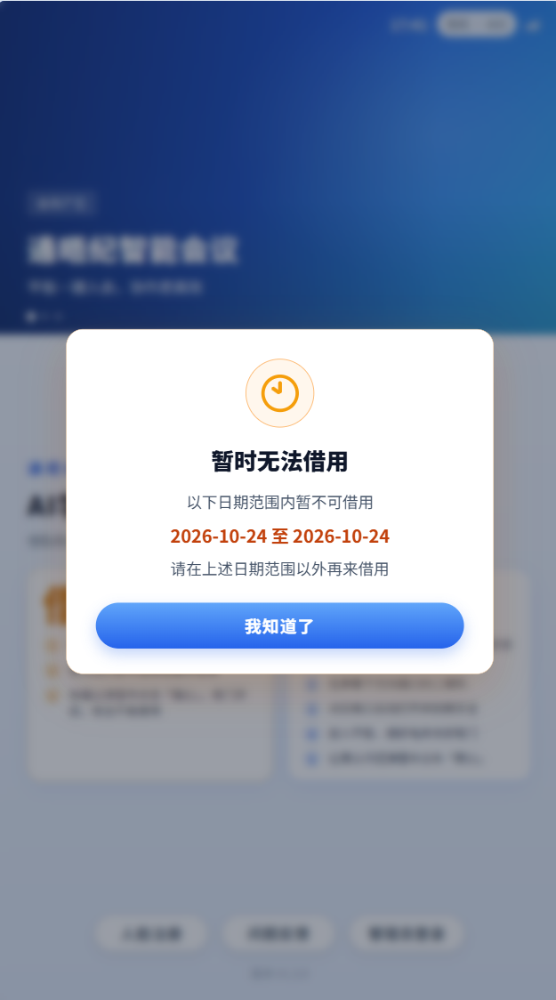

# AI学伴全校设备管控产品需求文档

版本：v3.25 ｜ 更新：2026-11-05

## 1. 需求概述

### 1.1 范围与权限

教师端「全校设备管控」仅学校管理员可见。管理员可操作全校或年级，最深到年级，不进入班级或学生页面。老师的角色权限和完整操作流程见[《微信小程序设备管控需求文档》](https://fcnw5yd4oj1w.feishu.cn/docx/Qcxdd67fIowvDOxLEl4cATd6ny2)。

| 管控模块 | 解决的问题 |
|-|-|
| 柜机借用 | 学生什么时候可以从柜机借出设备 |
| 使用时长 | 学生每天可以使用多久、什么时间可用 |
| 智阅作业 | 学生能否查看答案和详解 |
| 万象视界 | 学生能否进入万象视界 |
| 锁屏 | 学校临时限制学生继续使用设备 |

五个模块可同时生效，互不替代。

### 1.2 学校与老师设置的关系

| 模块 | 学校操作与老师设置的关系 |
|-|-|
| 柜机借用 | 学校停止借用及时间规则是上层限制，不改写班主任的学生禁借。解除学校停止限制后，继续按有效时间规则和班主任禁借判断。 |
| 锁屏 | 学校临时锁屏是上层限制，老师日常锁屏保留。解除后执行老师当前日常状态，不恢复开启前的旧快照；仍有日常锁屏时不会解锁。 |
| 使用时长 | 学校只更新老师未设置过的学生星期；老师明确保存默认值也受保护。 |
| 智阅作业 | 学校只更新老师未设置过的学生科目，不因一个科目已设置而跳过其他科目。 |
| 万象视界 | 学校只更新老师未设置过的学生权限；这是权限修改，不增加临时限制层。 |

以上保护适用于新增、编辑、删除、恢复默认及调整年级。学校配置独立保存，老师操作不回写学校规则列表。页面不提供覆盖老师设置的选项。

学校停止借用或临时锁屏期间，对应范围的老师不能调整该项日常管控，也不能自行解除学校限制。学校局部解除后，对应老师立即恢复原有操作权限，其他范围仍受限。

### 1.3 人员变化

- 新增学生执行所在年级当前学校规则，不追溯老师历史批量设置；临时限制跟随当前所在班级状态。
- 转班后借用时间规则及学校临时限制跟随新班级；已有学生禁借保留，由新班主任接手。其他模块不继承新班级老师历史批量配置；时长无其他规则时执行默认值，日常锁屏按转班规则重新计算，无日常设置默认未锁屏。

## 2. 通用交互

### 2.1 列表和年级范围

| 项目 | 统一要求 |
|-|-|
| 列表 | 年级为主信息，配置为次信息，操作靠右；相同配置合并年级 |
| 层级 | 不展示学段分组、年级卡片、班级下钻、分页或操作记录 |
| 选择年级 | 「全部」只选可操作项；禁用项不勾选；至少选择一个年级 |
| 新增 | 每周借用、使用时长、智阅仅选择没有人工规则的年级；已有规则的年级置灰 |
| 编辑 | 自动带入原年级和参数，可增加或取消年级；仅调整年级也属于修改 |

全部年级已有人工规则时，点击新增直接提示「全部年级已有规则，请编辑或删除后新增」。日期规则允许多条，仍可新增，但须校验日期是否重叠。

规则按完整配置合并展示，与创建批次或规则ID无关。合并后列出适用年级，编辑自动带入这些年级及原参数。

| 规则类型 | 合并条件 |
|-|-|
| 每周借用 | 所选星期、各天全部借用时段一致（含全天） |
| 日期禁借 | 起止日期一致，均为全天禁借 |
| 使用时长 | 星期、连续时长、休息时间、每日累计时长及可用时段全部一致 |

### 2.2 弹窗与反馈

| 项目 | 统一要求 |
|-|-|
| 弹窗 | 居中展示，内容可滚动，底部按钮固定；锁屏保留原视觉样式 |
| 必填 | 必填字段加红色*；可选时段不标必填 |
| 确认 | 借用、时长、智阅保存前确认年级和配置；万象直接保存；锁屏操作需确认 |
| 取消 | 不提交修改；返回表单时保留已填内容 |
| 反馈 | 校验和结果统一用顶部轻提示；成功只说结果，失败说明原因 |

五种管控均不展示学生人数或重复的范围摘要。无实际变化提示「无需修改」。使用时长和智阅设置弹窗底部仅保留取消、保存按钮。

### 2.3 保存与异常

- 保存成功才更新配置，失败或冲突整批不保存。编辑打开时不提示并发冲突；最终提交时校验原范围及新范围的相关版本，其他模块变化不阻止保存。
- 学校无年级时保留页面与Tab，显示缺省且不可设置；加载失败提供重试，不当作无规则。
- 对象关系变化时关闭设置、刷新并清空选择；配置变化时刷新相关数据并要求重新设置。无权限时停止查看和修改，提示联系平台管理员。
- 配置刷新后保留；设备离线不阻止服务端保存，联网执行最新有效状态，不补执行已解除的限制。取消和校验失败不产生成功记录。

## 3. 柜机借用管控

### 3.1 模块速览

柜机借用只控制新借出，不影响归还或已借设备的使用。

| 项目 | 要求 |
|-|-|
| 优先级 | 全校停止借用 ＞ 指定日期规则 ＞ 每周固定规则；无规则时默认可借 |
| 上方模块 | 「全校借用管控」，展示停止/恢复入口和已停止范围 |
| 下方列表 | 指定日期规则和每周固定规则分别为独立列表，底部各用居中长条新增按钮 |
| 列表顺序 | 指定日期在前，每周规则在后；各自保留标题和开关，开启时展示对应规则和新增入口 |
| 空状态 | 分别显示「暂无日期规则，可新增日期规则」「暂无每周规则，可新增每周规则」 |

两个列表的标题右侧各有一个「生效」开关，分别控制全校该类规则，默认开启，切换立即保存并在刷新后保留。

- 关闭暂停执行并隐藏对应列表（含空状态）及新增按钮，仅保留标题和开关；再次开启展开列表并恢复新增入口，按当前配置执行。
- 日期关闭后按已开启的每周规则判断；每周关闭后仍执行已开启的日期规则。两类均关闭或没有适用规则时默认可借。
- 学校停止借用和班主任禁借仍独立有效。暂停期间仍校验日期冲突及每周年级唯一性，过期日期照常自动删除；新增或编辑规则不会自动开启开关。

班主任学生禁借始终独立有效。底部提示「班主任禁止借用的学生由班主任解除后按照学校规则借用」。

### 3.2 每周固定规则

- 每年级仅一份完整每周安排。新增选择无每周规则的年级；编辑回填，删除移除该安排。
- 必填「选择星期」，旁注「时段不设置则全天可用」。按组勾选一天或多天，每组至少一天；星期不能跨组重复，已被其他组使用的星期禁选。
- 所选星期不设时段即全天可借，设置后仅时段内可借；未选星期不可借。一组可有多个时段，须起止完整、结束晚于开始、不跨日、不重叠；完全空白行忽略。
- 星期横排选择，可增删分组和时段；删除时段用图标，添加入口在其后。无时段时仍可添加。
- 编辑相同时段可合组，也可拆成每天不同安排；保存替换本条完整安排，移除的星期不继续保留。
- 确认摘要显示星期、时间及「可借用」，全天写「全天可借用」。删除后按剩余有效规则执行，无规则时默认可借。

### 3.3 指定日期规则

- 每年级允许多条，固定为所选日期全天禁止借用。日期范围包含起止日，可为同一天；同一年级的范围不得有交集，同一日期可用于不同年级。
- 必填年级及适用日期，日期标题旁显示「所选日期全天禁止借用」。新增开始不早于学校当天，结束不早于开始；编辑可保留过去的开始日期，但结束不得早于今天。
- 任一所选年级日期冲突，整批不保存，顶部提示「所选日期已有规则，请重新选择」；保留表单，需修改日期或年级后重试。编辑排除本条，最终提交重新校验。
- 保存即成为有效安排，仅在所选日期内禁止借用，不展示生效中等状态。学校时区Asia/Shanghai超过结束日期后自动删除，结束当天仍禁借；不影响其他规则和停止状态。
- 未过期规则可编辑、删除；删除或不在指定日期内时执行每周安排，没有每周安排则默认可借，仍受其他禁借限制。

### 3.4 停止及恢复借用

- 全校全部停止时主按钮「全校恢复借用」，否则「全校停止借用」。按实际停止范围判断。
- 模块下合并列出已停止年级，次文「已停止借用」。全校全部停止时，仅保留顶部「全校恢复借用」，隐藏行内重复按钮；部分停止时行内提供「恢复借用」。恢复部分后移除对应年级，全部恢复后该行消失。
- 停止或恢复时，默认选中可操作年级，其余置灰；确认范围后执行。
- 停止确认：「将禁止所选范围内的学生借出，已有借用规则保留」。恢复确认：「解除临时禁借后，按当前有效的借用规则执行」。成功后关闭。
- 停止限制需管理员手动恢复，刷新或退出不解除。可单独停止或恢复部分年级，调整时间规则不会解除停止限制。解除只撤销所选学校停止限制，其他范围及老师设置按1.2执行。

### 3.5 班主任禁借的共用边界

班主任只管理当前关联范围的禁借，不配置时间规则；不设学校授权开关，任课老师不提供借用管控。学生禁借持续到有权限的班主任手动解除，班主任更换不自动解除。具体老师操作流程见小程序文档。

### 3.6 保存与删除

保存确认显示年级和规则摘要；删除需确认。操作成功后更新列表，实际借用结果按3.1判断。

### 3.7 柜机借用拦截

- 本节为柜机借用拦截弹窗，不是借出后设备的锁屏。统一标题为「暂时无法借用」，仅提供「我知道了」按钮，无操作1分钟后关闭。
- 先判断学校临时禁借或班主任学生禁借，再判断当天有效日期规则，最后判断每周规则。没有当天有效日期规则且未设置每周规则时默认可借，不展示缺少规则的拦截弹窗。
- 弹窗中的日期、星期及时间由该学生当前所在班级的规则生成，图片中的日期与时段仅为示例，不可写死。
#### 3.7.1 每周规则拦截

当前未命中学校或班主任禁借、没有当天有效日期规则，且不在每周允许星期或时段内时，展示每周规则弹窗。

展示该学生所在班级的完整每周借用规则，包含所有已设置的星期及其全部时段，未设置时段的星期显示全天可借用；逐日的全部时段分行展示，不只展示今天或下一次可借时段。文案为「现在还不能借用哦，请在【完整每周规则】时间内再来借吧」。

#### 3.7.2 指定日期规则拦截

日期规则弹窗只展示当前命中的一条日期规则，不罗列全部日期安排。仅当学校时区当天处于该规则指定日期范围内时拦截，不因规则保存成功而禁止范围外的借用。

图示为指定日期全天禁借：显示「以下日期范围内暂不可借用」、该规则的起止日期及「请在上述日期范围以外再来借用」。包含起止日期；该日期范围外仍按其他有效规则及禁借状态判断，不保证一定可借。

指定日期规则仅有全天禁借，不再提供按时段允许借用的弹窗分支。

#### 3.7.3 学生禁借拦截

学校临时禁止该学生所在班级借用，或班主任禁止该学生借用时，展示禁借弹窗。文案为「当前学生编号不可借用」「如有疑问，请联系管理员」，不展示星期、日期或可借时段。

该提示优先于时间规则。学校临时禁借由学校解除，班主任学生禁借由当前关联班主任解除；界面不提供学生自行解除的入口。

## 4. 使用时长管控

### 4.1 模块速览

| 项目 | 要求 |
|-|-|
| 顶部说明 | 可按年级设置使用时长和可用时段，未设置时执行默认规则 |
| 列表 | 仅展示人工规则；相同配置合并年级，右侧编辑/删除 |
| 新增入口 | 列表底部居中长条按钮「新增自定义规则」 |
| 默认规则 | 周一至周日；连续60分钟、休息15分钟、每日累计180分钟、不限时段 |
| 默认展示 | 列表外上方固定展示，左侧为配置及适用年级，右侧灰色「默认规则」标签，只读 |

学校开关开启时，人工规则未覆盖的星期执行默认值；删除全部人工规则后，该年级回到默认范围。上方默认配置固定显示，无默认适用年级时不显示年级文字。列表只展示学校配置，老师设置按1.2保留。

列表标题右侧为「生效」开关，默认开启并持久化。关闭时隐藏人工规则列表及新增按钮，上方默认规则仍作为参考信息展示，但学校自定义及默认时长限制均暂停；老师设置过的星期继续执行老师规则，其他星期不受学校时长限制。开启后展开并恢复新增入口，恢复当前保存规则，不清空已用时长。

### 4.2 设置与校验

- 年级、星期、连续使用时长、休息时间、每日累计时长必填。三项为正整数分钟，每日累计不短于连续时长。
- 每年级每天仅一条学校规则。按组选择星期和三项参数，可每天不同，也可多天共用；星期不能跨组重复或与其他规则冲突，已有星期只能编辑或删除后再新增。
- 每日可用时段可选，标题旁「不设置则全天可用」。设定后仅时段内可用，仍受时长限制。星期和时段控件沿用借用规则样式及起止、不跨日、不重叠校验。
- 新增初始全周60/15/180、不限时段。所有组仍是默认值且无时段时，保存提示「当前仍为默认规则，无需新增」；仅改变分组不算自定义。
- 编辑回填参数与年级，可拆组；取消原年级移除本条，其余规则保留，空余星期回默认。一次校验全部组、整批保存。删除确认补充「删除后恢复默认设置」。
- 保存后立即按新规则判断，沿用当天已用时长，达到新上限立即限制。连续计时、休息、跨日、换设备及学生端提示沿用已开发规则。

## 5. 智阅作业管控

### 5.1 模块速览

| 项目 | 要求 |
|-|-|
| 顶部说明 | 可按年级设置查看答案和详解的权限，默认均不允许 |
| 列表 | 仅展示人工权限；相同配置合并年级，右侧「修改权限」「删除」 |
| 新增入口 | 列表底部居中长条按钮「新增自定义规则」 |
| 默认规则 | 不允许查看答案和详解；在列表外上方固定展示，配置及适用年级居左，灰色「默认规则」标签居右，只读 |
| 部分状态 | 单独列出实际权限，不用差异标签代替 |

表单必填年级、查看答案和查看详解。仍为默认权限时提示「当前仍为默认规则，无需修改」；已有允许改回不允许属于实际修改。编辑自动带入年级和权限，取消原年级后恢复默认，老师设置按1.2保留。

列表标题右侧为「生效」开关，默认开启并持久化。关闭时隐藏人工权限列表及新增按钮，上方默认规则仍作为参考信息展示，但学校人工和默认权限限制均暂停；老师已设置的学生科目继续按老师权限执行，其余不受学校答案、详解限制。开启后展开、恢复新增入口并执行当前配置。无默认适用年级时，上方仅显示默认配置。

### 5.2 科目与学生端

权限按学生及科目独立生效，答案与详解互不影响。学校统一设置所选年级全部适用科目，不显示科目选择。班主任可管理关联班级各科，任课老师只管理有效任教班级与科目；具体流程见小程序文档。学生打开作业读取对应科目权限。

当前原型使用不分科目的演示数据；逐科存储及老师逐科保护是开发要求，不代表原型已经实现。

## 6. 万象视界管控

### 6.1 模块速览

| 项目 | 要求 |
|-|-|
| 顶部说明 | 可按全校或年级停止、恢复使用万象视界 |
| 主模块 | 「全校万象视界管控」 |
| 主按钮 | 全校均禁止时为「全校恢复使用」，否则为「全校停止使用」 |
| 状态列表 | 合并展示已停止年级；无停止范围时隐藏 |
| 设置流程 | 选择年级后点击「保存」直接生效；已处于目标状态的年级置灰 |

部分学生停用时展示实际状态，不视为全年级停用。老师权限按1.2保留；学校临时锁屏不影响老师调整万象权限。

### 6.2 学生端

禁止后消息中心新增「万象视界已锁定」，入口拦截；正在浏览时弹出仅含「我知道了」的提示，确认退出。恢复后新增「万象视界已解锁」消息，不弹窗；无其他限制时可进入。

## 7. 设备锁屏管控

### 7.1 模块速览

| 项目 | 要求 |
|-|-|
| 顶部说明 | 可按全校或年级临时锁屏；解除后执行当前日常锁屏设置 |
| 主模块 | 「全校锁屏管控」 |
| 主按钮 | 全校均锁屏时为「全校解除临时锁屏」，否则为「全校临时锁屏」 |
| 状态列表 | 合并展示已锁屏年级；全校全部锁屏时仅保留顶部解除按钮，部分锁屏时行内提供解除入口；无范围时隐藏 |
| 设置流程 | 选择年级并确认；可操作年级默认选中，其余置灰 |

临时锁屏需手动解除，刷新或退出不解除。局部解除只撤销所选范围的学校限制，老师立即恢复日常操作权限；仍被学校锁定的范围不能调整日常锁屏，其他管控模块不受影响。

### 7.2 学生端锁屏页

- 锁屏页使用不透明背景覆盖学生端全部内容、底部 Tab 和更多应用入口。
- 顶部展示「学习守护｜老师已锁屏」、小晤、网络和反馈按钮。
- 页面提示设备已被老师锁定，并展示当前时间。
- 学生不能自行解锁；保留「退出登录」和「归还设备」。
- 小晤提示：「老师开启了锁屏，先休息一下，等老师解锁后再继续吧～」。

## 8. 开发要求

- 服务端校验学校归属、角色、有效关联关系与科目权限；不能仅靠前端隐藏或禁选。
- 学校配置和老师设置独立保存，来源及显式设置标记须可识别，包含老师保存默认值；所有写入强制执行1.2，不接受覆盖老师的参数。
- 使用时长、智阅执行时必须读取对应学校生效标记，再决定是否应用学校规则或默认值；关闭不删除配置、不改老师值，不能仅隐藏列表。借用按类型生效标记过滤参与判断的规则。
- 原型已实现开关保存、列表联动及规则判断测试；正式学生端的时长执行和智阅权限读取尚须接入生效标记。原型演示通过不代表正式设备执行已上线。
- 最终提交同时校验新旧范围的对象及相关版本，整批写入。借用使用学校配置版本，时长/万象按学生模块，智阅按学生科目；不能只凭当前值相同跳过冲突。
- 日常锁屏与学校临时限制分开保存，按当前所属范围计算；解除不恢复旧快照。重复请求幂等，新增/转班及时同步临时状态。
- 服务端按学校时区自动清理过期日期规则，不依赖管理员在线；仅清理过期日期，有实际变化才更新版本，不提示人工操作成功。
- 配置持久化，在线同步、离线恢复同步最新有效状态。保留必要的成功变更追溯数据，页面不提供记录入口。

## 9. 验收重点

1. 管理范围至年级，五个Tab均按规则或状态列表展示；选择、回填、年级迁移和默认行符合通用交互。
2. 学校借用与锁屏是上层限制，不改老师设置；解除后执行当前规则。时长、智阅、万象的新增/编辑/删除及移除年级都保留老师设置。
3. 借用每周唯一、按组或逐日设置、空时段全天可借；日期允许多条且不重叠、过期自动删除；无规则默认可借，班主任禁借始终有效。
   两类生效开关独立控制并持久化，关闭保留配置、按其余有效规则判断，学校停止和班主任禁借不受影响。
4. 停止/恢复及锁屏可局部操作，目标已达成年级禁选，列表和主按钮按实际状态更新。
5. 时长默认60/15/180；每日规则唯一，默认值不重复新增。智阅两项默认不允许；删除恢复默认，逐科开发能力与原型边界明确。
6. 万象入口拦截、浏览退出和恢复消息正确；锁屏覆盖学生端，学生不能自行解锁。四张柜机/学生端原图保留。
7. 全部年级已配置时新增直接提示；保存必填、日期/时段冲突、并发、失败和取消均不误写，反馈统一顶部且不显示学生人数。

## 附录：统一提示文案

正文已定义的页面标题、说明及确认文案直接沿用，不在此重复。

| 场景 | 文案 |
|-|-|
| 全部年级已有人工规则 | 全部年级已有规则，请编辑或删除后新增 |
| 新增时长仍为默认值 | 当前仍为默认规则，无需新增 |
| 智阅仍为默认权限 | 当前仍为默认规则，无需修改 |
| 日期冲突 | 所选日期已有规则，请重新选择 |
| 未选年级 | 请选择年级 |
| 配置冲突 | 相关设置已被其他人修改，本次未保存，请重新设置。 |
| 对象变化 | 所选范围的学生或班级已变化，请重新选择后设置。 |
| 保存失败 | 保存失败，请检查网络或稍后重试。已填写的内容已保留。 |
| 学校停止借用期间老师操作 | 学校正在临时禁止借用，暂时无法修改 |
| 学校临时锁屏期间老师操作 | 该班正在临时锁屏管控中，暂时无法修改锁屏状态。 |
| 无实际变化 | 无需修改 |
