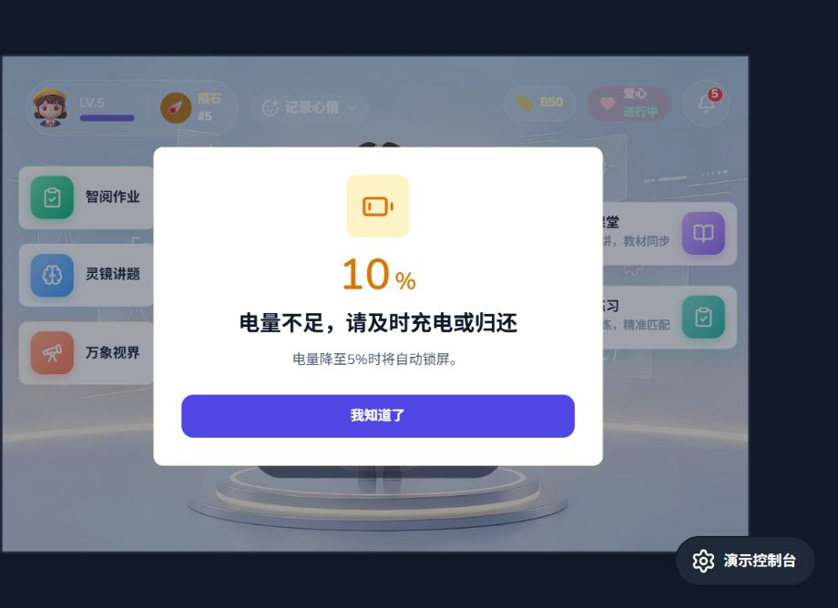
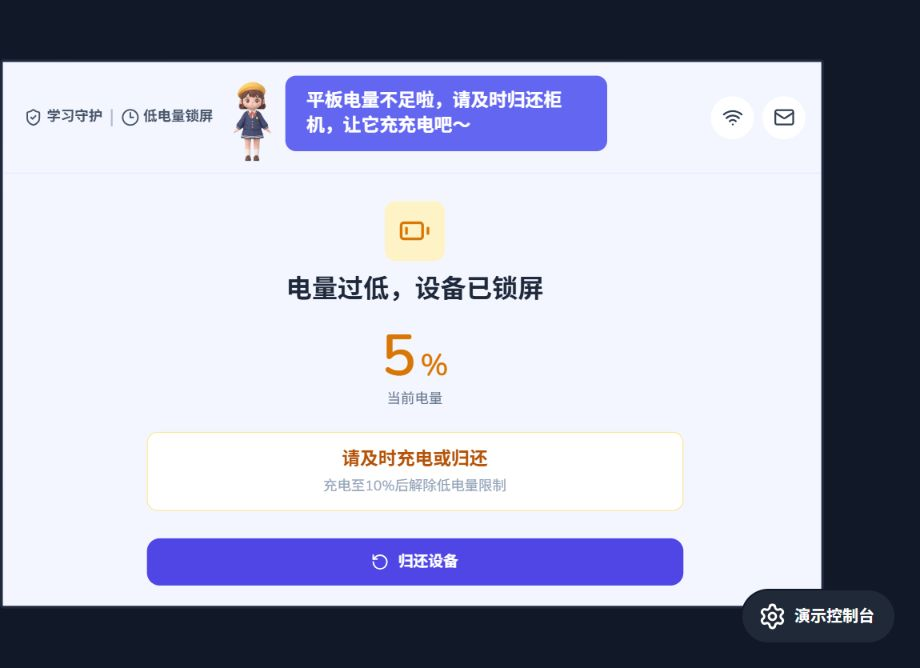

# 学生端平板低电量归还方案

日期：2026-10-24。功能：DEV-001 设备借还；联动 CTL-001 学生端锁屏。
状态：核心规则已确认，交互原型已完成，真实硬件数据与设备级锁屏尚未接入。

## 1. 目标与决策来源

用户最新确认：每次账号登录后，首次取得有效电量时，只要未充电且处于6%～10%就进入低电量提醒阶段，强弹窗仅提供「我知道了」；≤5%直接锁屏。消息中心不显示低电量提示。充电或可信设备数据证明电量已达到≥10%时，仅解除低电量限制，不提醒。每次未充电下降至10%均弹窗，同一轮连续下降、切页、重启不重复；学生退出登录后重新登录，可在仍满足条件时再次提醒。老师锁屏与低电量锁独立生效。

以下将阈值解释为包含边界的判断，补充交互与异常规则作为本次设计建议。适用于借出中的学校平板，不新增后台阈值配置。

归还沿用《apps/cabinet/柜机借还流程与异常整理.md》：柜机发起归还、扫码关联原借用、放入原格口、充电和关门校验通过后，才认定已归还。插电、充电达标、点击归还按钮均不代表归还完成。

## 2. 状态与阈值

| 状态 | 进入条件 | 学生端表现 | 离开条件 |
|---|---|---|---|
| 正常可用 | 未触发低电量锁，电量>10% | 正常使用 | 未充电进入6%～10%时提醒；≤5%优先锁屏 |
| 低电量提醒 | 每次登录后首次有效电量或后续电量变化满足：未充电且6%～10% | 每轮未充电下降至10%时强弹窗一次，确认后可继续使用；消息中心不显示低电量提示 | ≤5%锁屏；可信设备数据证明电量已达到≥10%后恢复正常可用状态 |
| 低电量锁屏 | 电量≤5%，无论是否插电 | 全屏锁定学习与应用，仍可归还；若10%弹窗尚未确认，锁屏立即覆盖并终止该弹窗 | 可信设备数据证明电量已达到≥10%时解除低电量锁，不弹窗 |

锁屏一旦触发，在6%～9%区间仍保持锁屏，拔插充电线不能解锁。可信设备数据证明电量已达到≥10%时解除低电量锁；应用恢复时即使设备已经拔线，只要当前可信电量≥10%也可解除。若老师锁屏或其他限制仍生效，继续执行相应限制。

提醒去重按每轮低电量下降阶段保存，不限制同一登录会话的总次数。同一轮已提醒后，切页、刷新、重启和连续下降不重复；充电回升本身不提醒，回升后每次未充电再次下降至10%都重新提醒，无需退出登录。退出登录并重新登录后，若首次有效电量仍为未充电且6%～10%，可再次提醒。

## 3. 强提醒弹窗

覆盖当前学生端页面，在首页、学习、答题、视频及更多应用期间均应可触达。暂停音视频，保留当前作答与页面上下文。低电量事件不写入消息中心。

首次进入低电量提醒：

> **电量不足，请及时充电或归还**
> 电量降至5%时将自动锁屏。
> 唯一按钮：我知道了

强弹窗仅提供「我知道了」，必须主动点击确认；无右上角关闭，不支持点击遮罩、返回键或倒计时自动关闭。“我知道了”仅关闭弹窗，此阶段不禁止继续学习。弹窗未确认期间若电量降至≤5%，立即关闭弹窗并切入低电量锁屏；后续解除锁屏后不恢复这张旧弹窗。

可信设备数据证明电量已达到≥10%时，只解除低电量锁，不展示电量恢复或待归还弹窗。老师锁屏仍生效时继续显示老师锁屏页。

每轮未充电下降至10%弹一次，同一登录会话可触发多轮；切页、刷新、重启或电量连续下降均不再次触发。需持久化本轮已触发标记，充电回升后允许下一轮下降至10%再次提醒，不以是否点击「我知道了」作为重新触发依据；明确退出登录后清除该登录会话的提醒标记，重新登录时重新判断。处于归还二维码页时不以弹窗遮挡二维码：若停留期间首次进入未充电6%～10%，暂缓展示，点击返回后仍满足条件则补弹一次；归还成功则取消该次待弹提醒。

> 2026-10-30最新弹窗截图。

## 4. 低电量锁屏页

沿用学生端现有锁屏的平板布局，使用不透明背景覆盖内容、底栏和更多应用。主体采用电池图标与醒目电量，避免“老师已锁屏”表述。锁屏中间区域仅实时展示设备真实电量百分比，在数值下方显示“当前电量”；不展示充电状态。电量必须接入设备真实数据，不能使用固定演示值或仅在进入页面时读取一次。

> 2026-10-30更新：仅保留居中的「归还设备」按钮，宽度保持原版。

| 页面区域 | 内容 |
|---|---|
| 标题 | 电量过低，设备已锁屏 |
| 电量 | 实时显示设备当前真实电量：{电量}% |
| 电量标签 | 数值下方显示“当前电量”，不显示“未充电／充电中”。 |
| 主提示 | 请及时充电或归还 |
| 辅助说明 | 充电至10%后解除低电量限制（弱化展示）；删除标题下方“请及时将平板归还柜机”。 |
| 主按钮 | 归还设备 |
| 按钮规则 | 仅保留「归还设备」，不提供「退出登录」入口 |

没有“继续使用”、手动解锁或退出登录入口。低电量锁为设备级限制，不因其他入口退出登录、切换账号或归还失败而解除。正常页面保留退出登录功能。点击归还设备可展示二维码；二维码页返回后仍是锁屏，不能借此进入其他页面。

锁屏停留期间，电量从5%变化到6%～10%以及充电线插入、拔出时，页面中的电量须随设备数据实时更新，充电状态仅用于内部规则判断，无需刷新页面或重新进入锁屏。显示和阈值判断使用同一份设备数据，避免页面显示值与实际解锁条件不一致。

达到≤5%立即切入锁屏，不等待题目做完或视频播放完；尽力保存草稿、暂停计时与音视频，不自动提交、不结算奖励。保存失败不阻塞锁屏，恢复后按现有学习恢复能力处理，不承诺所有模块无损续学。

## 5. 硬件与异常处理

- 电池事件由设备系统层提供有效电量、充电状态、采样时间；启动、唤醒、锁屏展示期间的电量变化及充电状态变化均须主动订阅并实时刷新页面，离线也执行阈值判断。具体设备平台、事件频率与系统管控能力需硬件联调确认。
- 页面展示必须使用设备层最新有效值，不得用前端倒计时推算电量。收到新数据后更新电量百分比；充电状态仍需读取用于提醒条件判断，但页面不展示。
- 按区间判断，支持11%直接跳到4%；≤5%直接锁屏，不先排队展示10%弹窗。
- 低电量锁标记与借用标识需可恢复，不能只保存在页面临时状态；重启、切账号、退出登录不清除设备锁。提醒已触发标记按本轮下降阶段保存，应用重启不重置，明确退出登录后清除。已锁设备重启显示7%仍锁；应用恢复时取得可信电量≥10%，即使当前未充电，也可解除低电量锁。
- 电量或充电状态未知、上报中断时不按0%或未充电处理，也不凭未知值解除已有锁；保留低电量锁并重新读取。电量未知时显示“电量读取中”，不展示充电状态占位文案，恢复有效数据后自动更新。
- 硬件层负责阻止返回键、桌面及切换第三方应用绕过锁屏；网页遮罩只能演示效果，不能作为实机锁定验收依据。
- 老师解除管控不能解除低电量锁；电量恢复不能解除老师管控。各限制独立保存，仅当所有适用限制解除时恢复学习。
- 归还成功后结束本次借用与当前登录提醒会话，清除待弹提醒和原学生关联，不再给原借用学生触发低电量提醒；设备≤5%时仍保持设备级电量保护。归还失败或取消时不清除提醒阶段和低电量锁，返回后继续执行原状态。柜机后续可借电量门槛沿用其独立规则，不用本方案10%替代。

## 6. 验收场景

| 场景 | 预期 |
|---|---|
| 登录后首次数据为未充电10%、8%或6% | 当前登录会话展示一次强弹窗，仅「我知道了」；确认后可以继续使用，消息中心无低电量提示 |
| 登录后首次数据≤5% | 不展示10%弹窗，直接进入低电量锁屏 |
| 11%→10% | 未充电下降时展示一次强弹窗；每次重新下降至10%均提醒，同一轮持续下降不重复 |
| 10%→9%→6%，切页或重启 | 不重复弹窗；重启不重置当前登录会话的已提醒标记 |
| 10%弹窗未确认时降至5% | 立即关闭弹窗并进入锁屏；充至≥10%解锁后不恢复旧弹窗 |
| 6%→5%，或11%→4% | 直接锁屏，学习暂停，可打开归还二维码 |
| 锁屏后插电，5%→9% | 持续锁屏；拔插线、退出登录均不能绕过 |
| 充电9%→10%，仍借出 | 只解除低电量锁，不弹窗；仍有老师锁屏则继续锁定 |
| 锁屏后离线充至12%，拔线后恢复应用 | 当前可信电量为12%，解除低电量锁，不要求恢复时仍处于充电中 |
| 解锁后再次下降至6%～10%，未退出登录 | 充电回升后再次未充电下降至10%时重新提醒，消息中心无低电量提示 |
| 小明已提醒后退出登录，再次登录时仍为未充电6%～10% | 新登录会话再次展示一次强提醒 |
| 归还二维码页停留期间降至6%～10%，随后点击返回 | 二维码页不被遮挡；返回后仍满足条件则补弹一次 |
| 归还成功／失败或取消 | 成功时清除待弹提醒和原学生关联；失败或取消时保持原提醒阶段或低电量锁 |
| 老师锁屏与低电量锁同时存在 | 任一原因解除后，另一原因仍限制使用 |
| 离线、重启、第三方应用前台 | 阈值执行有效，提醒及锁屏不依赖首页或联网 |

补充验收：每轮下降阶段展示一次强提醒，同一登录会话可有多轮；退出登录并重新登录后重新判断。低电量锁为设备级限制，不因退出登录、切换账号或归还失败而解除。

## 7. 当前实现核对与后续落点

当前分支核对到：`DeviceLockDemo.tsx` 已增加10%强提醒与5%锁屏循环演示，但尚不能证明系统级锁屏或真实电池数据接入；设备归还业务与充电校验已有文档约定。本次不将这些记为实机功能已实现。

实施时最小落点：设备电池适配与独立状态服务、全局强提醒、低电量锁屏页及现有归还二维码入口。`App.tsx` 仅编排全局层；若增加浏览器演示存储，同步维护 `demoStateService.ts`。硬件阈值、真实电量与充电状态、实机防绕过另做联调验收。

## 管控使用时间统计（2026-10-30确认）

- 低电量锁屏期间不计入管控使用时间统计，包括连续使用时长和每日累计使用时长。
- 进入低电量锁屏时暂停计时；解除低电量锁后，仅在满足其他管控条件并恢复实际使用时继续计时，不补计锁屏期间的时长。
- 低电量锁与老师锁同时存在时，解除其中一种限制不代表恢复计时。
